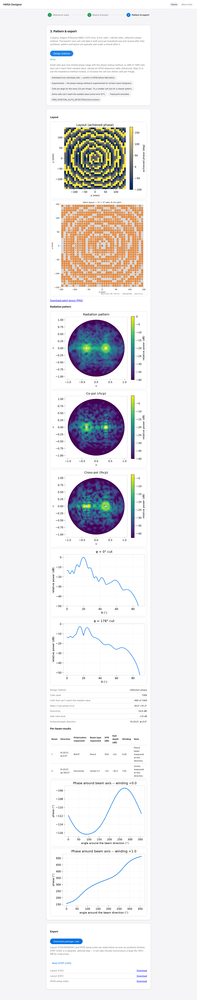

# HMSA Designer & RIS Metasurface Toolkit (`lwmom`)

A Python periodic Method-of-Moments solver for metasurface unit cells, plus a local web app ("HMSA Designer"):
- **HMSA Design:** Design holographic and reflectarray metasurface antennas end to end: upload a monopole feed's measured surface-wave field, configure multi-port beams and board geometry, synthesize holograms with sidelobe optimisation, predict far-field patterns, and export HFSS-ready CAD and AEDT scripts.
- **RIS Track (Phase 20):** Design 2-bit PIN-diode reconfigurable intelligent surfaces at X-band (10.5 GHz CP-2 Pancharatnam–Berry cell family and 1-bit LP interim), with plane-wave beam steering, coding synthesis, diode tolerance modeling, and board export.



Read **[docs/START_HERE.md](docs/START_HERE.md)** first — purpose, design flow, repo map,
conventions that bite.
Then **[docs/ROADMAP.md](docs/ROADMAP.md)** for deliverables, completed phases, and active track.
Check **[docs/STATUS.md](docs/STATUS.md)** for what's validated right now.

## Install and run

```bash
python3 --version                   # must be >= 3.11 -- if not, substitute your 3.11+
                                     # interpreter below (e.g. python3.12, python3.14, pyenv's)
python3 -m venv .venv && source .venv/bin/activate
pip install -e ".[dev,app,cad]"     # dev: tests/lint; app: the web app; cad: STEP export/plots
make app                            # starts the app at http://127.0.0.1:8000 -- restart after
                                     # any backend (src/) change, there is no autoreload
make test-fast                      # pytest -m "not slow", ~6-7 min
make test-full                      # everything, including real MoM solves, tens of minutes
make lint / make format             # ruff check(+format) / ruff check --fix + format
```

Python >= 3.11. `requirements-lock.txt` reproduces the exact pinned environment this project was
developed against (`pip install -r requirements-lock.txt`). See `docs/DEVELOPING.md` for the full
setup/test/lint walkthrough and `docs/ARCHITECTURE.md` for how the app is put together.

## More

- [docs/START_HERE.md](docs/START_HERE.md) — onboarding (humans and AI agents).
- [docs/ROADMAP.md](docs/ROADMAP.md) — planned deliverables, completed phases, and active milestones.
- [docs/STATUS.md](docs/STATUS.md) — current validation level per capability, open next steps.
- [docs/USER_GUIDE.md](docs/USER_GUIDE.md) — walkthrough of every app page.
- [docs/ARCHITECTURE.md](docs/ARCHITECTURE.md) — module map, data flow, job queue, storage.
- [docs/validation/README.md](docs/validation/README.md) — every validation run, with numbers.
- [docs/history/](docs/history/) — the full phase-by-phase project history.
- [jobs/README.md](jobs/README.md) — remote compute server job architecture and status matrix.
- [hfss_results/README.md](hfss_results/README.md) — external HFSS simulation runs and ground-truth data.
- [CHANGELOG.md](CHANGELOG.md), [CONTRIBUTING.md](CONTRIBUTING.md), [CLAUDE.md](CLAUDE.md).
