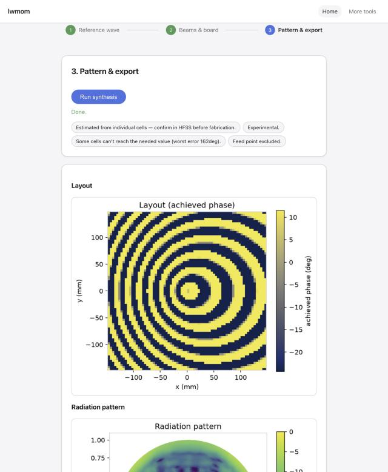

# HMSA Designer (`lwmom`)

A lightweight Python Method-of-Moments solver for periodic metasurface unit cells, plus a local
web app that designs holographic/reflectarray metasurface antennas (HMSA) end to end: upload a
monopole feed's measured surface-wave field, pick beam directions and a board, get a synthesized
hologram, a predicted far-field pattern, and an HFSS-ready export.



Read **[docs/START_HERE.md](docs/START_HERE.md)** first — purpose, design flow, repo map,
conventions that bite. Then **[docs/STATUS.md](docs/STATUS.md)** for what's validated right now.

## Install and run

```bash
python3 -m venv .venv && source .venv/bin/activate
pip install -e ".[dev,app,cad]"     # dev: tests/lint; app: the web app; cad: STEP export/plots
make app                            # starts the app at http://127.0.0.1:8000 -- restart after
                                     # any backend (src/) change, there is no autoreload
make test-fast                      # pytest -m "not slow", < 5 min
```

Python >= 3.11. `requirements-lock.txt` reproduces the exact pinned environment this project was
developed against (`pip install -r requirements-lock.txt`). See `docs/DEVELOPING.md` for the full
setup/test/lint walkthrough and `docs/ARCHITECTURE.md` for how the app is put together.

## More

- [docs/START_HERE.md](docs/START_HERE.md) — onboarding (humans and AI agents).
- [docs/STATUS.md](docs/STATUS.md) — current validation level per capability, open next steps.
- [docs/USER_GUIDE.md](docs/USER_GUIDE.md) — walkthrough of every app page.
- [docs/ARCHITECTURE.md](docs/ARCHITECTURE.md) — module map, data flow, job queue, storage.
- [docs/validation/README.md](docs/validation/README.md) — every validation run, with numbers.
- [docs/history/](docs/history/) — the full phase-by-phase project history.
- [CHANGELOG.md](CHANGELOG.md), [CONTRIBUTING.md](CONTRIBUTING.md), [CLAUDE.md](CLAUDE.md).
