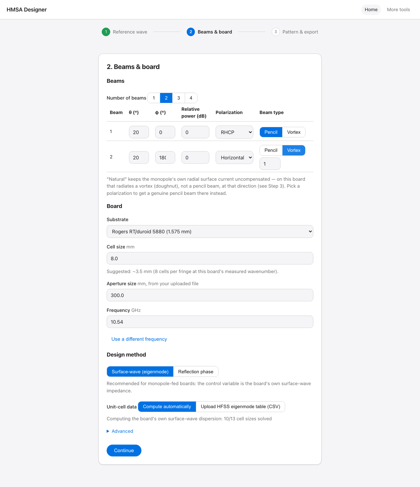
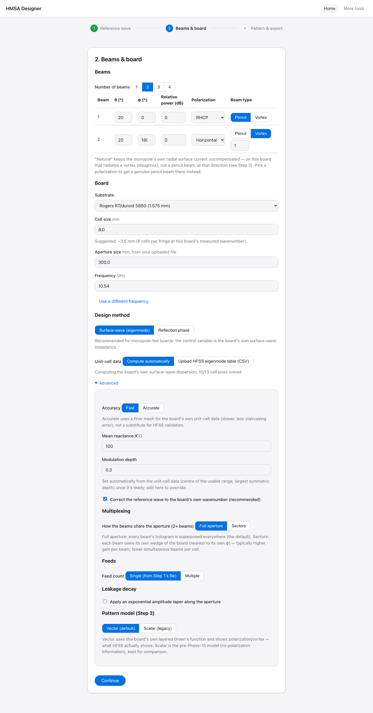
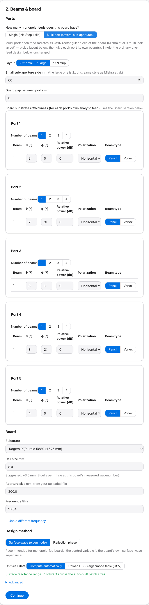
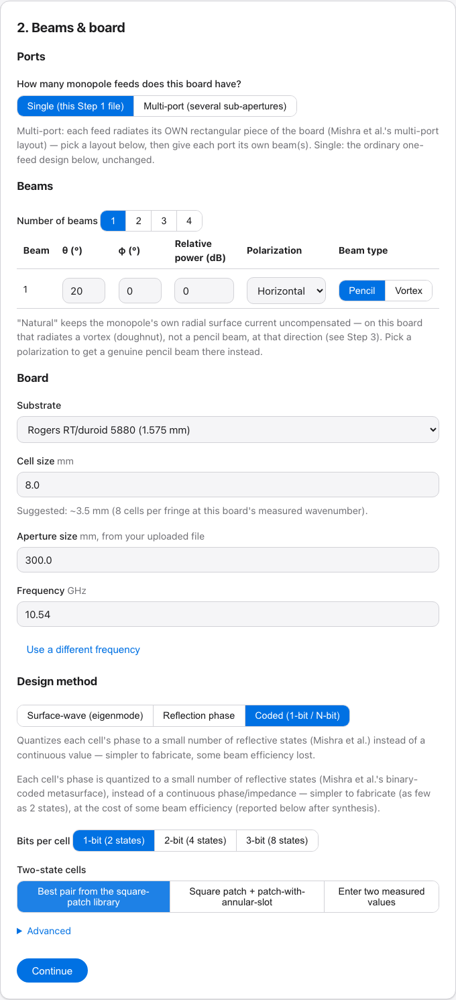
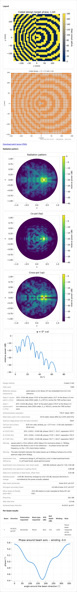
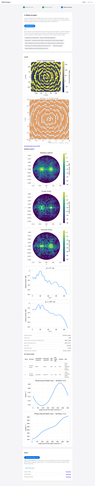

# User guide — the local web app ("HMSA Designer"; `lwmom` is the Python package)

`make app` (or `lwmom-app`) starts the backend and opens `http://127.0.0.1:8000` in your browser.
Everything below runs locally; nothing leaves the machine. A real walk-through's own screenshots
are checked into `docs/screenshots/`; fresh ones after Part 3D's fixes were not captured — no
browser or screenshot tool was available in the session that made those fixes (see
`docs/phases/PHASE13_WEBAPP.md` "Known limitations"). Phase 15's own screenshots (`phase15_*.png`)
ARE fresh, from a real walk-through of the Phase 15 UI (polarization/beam-type columns, Advanced's
new sections, Step 3's per-beam table) run against the live app in a real browser.

The home page is a 3-step HMSA (holographic metasurface antenna) designer wizard — the app's main
flow. Everything else (single unit-cell solves, a standalone reflectarray designer, full-wave
verification, HFSS comparison) lives one click away under **More tools**.

## The 3-step wizard

### Step 1 — Reference wave

Upload an HFSS field-calculator `.fld` phase export (phase; magnitude optional — drag-and-drop or
"choose a file"), and the frequency it was exported at (the file itself doesn't record this).
"Analyze" shows immediately: a PNG of the reference phase map, and a plain-language summary line
naming the actual substrate you'll pick in Step 2 and comparing the field's own measured
surface-wave wavenumber against that substrate's analytic bare-slab TM0 value (a sanity check,
never a requirement — a mismatch is shown as a warning, not blocked; this line re-checks itself
whenever Step 2's board changes). The one documented feed-point NaN a real export carries is
interpolated and reported (`FEED_REGION_MASKED`), never silently dropped.

### Step 2 — Beams & board

**Beams**: 1–4 object-beam directions (θ, φ in degrees) with a relative power in dB (converted to
a field-amplitude weight internally — power ratio = amplitude²), plus (Phase 15 Part A) a
**Polarization** and a **Beam type**:

- **Polarization**: Natural (no compensation — this board's monopole feed has a *radial* surface
  current, so "Natural" radiates a **vortex**, not a pencil beam, at that direction; see the "Why"
  note under the beam table and Step 3's measurement of it), Horizontal, Vertical, Slant ±45°,
  LHCP, RHCP. Choosing anything other than Natural adds a per-beam hologram compensation term so
  the aperture radiates a genuine pencil beam of that polarization instead (derived in
  `docs/phases/PHASE15_POLARIZATION_VORTEX.md`).
- **Beam type**: Pencil (the default for a new row) or Vortex, with an OAM charge field that
  appears once Vortex is selected — deliberately requests an orbital-angular-momentum beam instead
  of (or on top of) the polarization choice.

**Advanced** also gains (Phase 15):

- **Multiplexing** (2+ beams): Full aperture (default — every beam's hologram term is superposed
  everywhere) or Sectors (each beam owns its own wedge of the board, nearest to its own φ).
- **Feeds** (Part C, "multipole" support): Single (from Step 1's own uploaded file, the default) or
  Multiple — add feed rows (position, amplitude, phase; each optionally with its own uploaded
  `.fld`, or an analytic surface-wave model using the board's own εr/thickness otherwise), a
  Superposition/Segmentation combination strategy, and a per-beam "Feed" column that appears in the
  beam table once 2+ feeds exist.
- **Leakage decay**: an optional exponential amplitude taper `e^(-αρ)` along the aperture (off by
  default; you supply α — this project does not derive it from the board's own data).
- **Pattern model** (used in Step 3): Vector (default) — the real polarization/vortex-aware model,
  via this board's own layered Green's function — or Scalar (legacy), the pre-Phase-15 model kept
  for comparison (no polarization information).

**Board**: a substrate preset (Rogers RT/duroid 5880, RO4003C, FR-4, or Custom εr/loss
tangent/thickness) and a cell size (a suggested value appears once Step 1's field is analyzed,
targeting 8 cells per surface-wave fringe at this board's own measured wavenumber). Aperture size
is shown read-only, taken from the uploaded file's own extent — there is no cropping/resizing
logic, so this is informational, not editable (an honest scope reduction from what was asked for).
Frequency is pre-filled from Step 1 and locked; "Use a different frequency" unlocks it, and a
mismatch against Step 1's frequency is flagged.

**Design method** (Phase 14): **Surface-wave (eigenmode)** — recommended for monopole-fed boards,
the default — or **Reflection phase** — simpler, but with a limited phase range at small cell
sizes (Part 3D's own finding: ~33-36° of range with 4 mm cells on RT/duroid 5880, most cells
clipping to the smallest or largest patch). The eigenmode method has its own choice of unit-cell
data: *Compute automatically* (default — builds a real surface-wave dispersion table for this
board from this project's own MoM, via a homogenized patch-admittance model; `docs/phases/
PHASE14_EIGENMODE.md`) or *Upload an HFSS eigenmode table* (CSV: patch size, beta or reactance, at
one frequency). As soon as board, cell size and frequency are set, a preview line shows the chosen
method's achievable range — the phase range (reflection) or the surface-reactance range across the
auto-built patch sizes (eigenmode) — while it computes in the background (a few seconds, cached
after the first time for a given board).

For the eigenmode method, the mean reactance X̄ and modulation depth are set automatically from the
table (the centre of the usable range, the largest symmetric depth) — editable under Advanced.

**Advanced** (collapsed): an **Accuracy** control (Fast/Accurate — Accurate uses a finer mesh for
the board's own unit-cell data; slower, less staircasing error, not a substitute for HFSS
validation, not Richardson extrapolation) and whether to rescale the reference wave to the board's
own guided wavenumber β̄ (on by default — using the raw bare-slab wave as-is accumulates a phase
error across the aperture, reported if you turn this off).

The unit-cell data either method needs is built automatically the first time it's needed for a given
board/frequency (cached — later runs with the same board reuse it instantly). You never visit a
separate library page.

**Ports (multi-port sub-apertures)**: choose "Multiple ports" to split the board into several feed
sub-apertures, each with its own feed, beam table and polarization. Layout presets: 2×2 small ports
plus one large port, a row of N ports, or a custom list. Step 3 reports per-port directivity and
aperture efficiency, and a first-order edge-distance check between ports (in units of λ_sw). That
check is a heuristic, not a full-wave isolation result. Each port is designed against its own
analytic surface wave; there is no per-port field upload yet, so expect more unreachable cells than
a single aperture built from an HFSS field. The Coded method is not offered for multi-port designs.

**Coded (1-bit / N-bit)**: a design method that quantizes the phase target to two (1-bit) or 2^N
reflective states, as in Mishra et al. (IEEE TVT 2026). The two-state source is one of:
square-patch library (the best pair whose two states both carry the TM0 surface wave with agreeing
β), square plus annular-slot library (the same rule across both families), or two HFSS-measured
complex values you enter. A 1-bit design needs the substrate values in Step 1 for its surface-wave
check. N-bit designs need a continuous phase library.

### Step 3 — Pattern & export

**Coded checks (Step 3)**: the reflection phases and magnitudes of both states at the patch plane and at
the library's 5 mm reference, each state's β and X_s, the mean β used in the coded phase, the cell size
and λ_sw/cell, the ±5% frequency rows, warnings (resonance proximity, magnitude mismatch, β mismatch at
the aperture edge), the quantization loss with its textbook comparison, and the strongest secondary
beam and the mirror beam.

A one-line summary (beam count, board, cell size, method) appears before you run. "Design antenna"
chains: builds/reuses the board's unit-cell data (library or dispersion table, whichever the chosen
method needs) → synthesizes the hologram → predicts the far-field pattern → builds the layout
export (CSV/JSON/DXF) and HFSS notes. Shows the layout preview, the radiation pattern (a 2-D u–v
map in dB, one principal cut per requested beam), directivity, side-lobe level, achieved beam
direction, which design method and data source were used, and (reflection-phase method only) how
many cells couldn't reach their required value (with the mean/max phase error) — if that's more
than 20% of the cells, a plain sentence explains why (the phase-lookup method's limited range at
small cell sizes) and what to do about it (switch to the eigenmode method, or use a larger cell).
On the walk-through's own case, the eigenmode method reaches all 5476 cells vs. the reflection-phase
method's 4006 unreachable (`docs/phases/PHASE14_EIGENMODE.md`).

STEP (CAD) is a separate, explicit "Build STEP (CAD)" action — it can take minutes and produce a
file well over 100 MB for a large array, so it no longer runs automatically as part of the chain
above; its own status line shows an estimated progress percentage (from Phase 12D's own measured
runtimes, log-log interpolated — labelled "estimated," never claimed as measured) while it runs.
**Download package** bundles whatever's been built (layout CSV/JSON/DXF, HFSS notes, STEP if you
built it, every plot, and a project record) into one zip; the individual files are also linked
separately.

Export requires a real per-cell L×W assignment, which only Formulation B (reflection-phase)
currently produces — Formulation A's (eigenmode/impedance) achieved quantity is a surface
reactance, not a geometry pair, so it doesn't chain into Export. Pattern prediction works for both
methods (Phase 14 Part C added an aperture field for the eigenmode method too, a documented
leaky-wave-perturbation approximation).

**Phase 15 Part D — per-beam results (vector pattern model).** With Pattern model left at Vector
(the default), Step 3 also shows co-pol/cross-pol u–v maps (for the first beam's own polarization,
if it has one) and a **per-beam results table**: direction, polarization requested, beam type
requested, XPD (dB), null depth (dB) and phase winding number at that direction — measured against
the actual computed pattern, not assumed — plus a plain-language note and a phase-around-beam-axis
plot (a straight line for a pencil beam, a full sawtooth cycle per unit of winding for a vortex).

In the screenshot above, beam 1 (RHCP, Pencil) measures a clean 19.8 dB XPD pencil beam with ~0 dB
null depth and ~0 winding at its own direction; beam 2 (Horizontal, Vortex charge 1, same
direction) measures a genuine −30 dB null with winding ≈ +1.0 — the vortex is requested and then
independently *measured*, matching the design. Scalar (legacy) skips all of this (`per_beam` is
empty) and reproduces the pre-Phase-15 pattern exactly.

## More tools

Lower-level pages the wizard uses internally, useful directly for a reflectarray (not HMSA) design
or for inspecting a single cell/library/design without going through the full flow. Same
request → poll → result pattern throughout: a status line polls (`queued` → `running` →
`done`/`failed`), then a table of results plus label pills — read these; they're the app's honesty
mechanism, not decoration. A `failed` job's status line shows the error message; the underlying
error also has a stable `code` (e.g. `CONFIG_INVALID`, `SOLVE_FAILED`, `IMPEDANCE_UNREACHABLE`,
`LIBRARY_FREQUENCY_UNAVAILABLE`) if you're scripting against the API directly.

### Unit cell

Solve one rectangular-patch unit cell (grounded, `backing: pec`, one port; or ungrounded, two
ports) at one frequency or a comma-separated list. **Mesh mode**:
- `fast` — solves once at the mesh you specify; always labelled `MESH_NOT_CONVERGED` since it was
  never checked against a finer mesh.
- `richardson` — runs a small family of mesh sizes and Richardson-extrapolates to the zero-cell-
  size limit (Part 0's own addition). The table shows the EXTRAPOLATED S11, not the finest raw
  solve, with an error bar (the size of the extrapolation correction — a fit-covariance number
  from as few as 4 points was found not to be a credible uncertainty); labelled `MESH_CONVERGED`
  or `MESH_NOT_CONVERGED` depending on whether the fit actually converged (a flat or
  non-monotonic sequence is reported honestly, not forced).

"Export STEP" builds the same unit cell's physical geometry (substrate + zero-thickness-modelled
patch, drawn at a configurable thickness for CAD purposes only) and downloads a `.step` file.
Needs the optional `cad` extra (`pip install -e '.[cad]'`) — fails with `CAD_UNAVAILABLE`
otherwise.

### Library

**Browse**: pick a registered library (the read-only Phase 7 benchmark — 324 cells, 4.8 mm,
ungrounded, flagged with its own duplicate-geometry caveat — or one you've built, including any
the wizard auto-built) and a frequency; see its phase-vs-geometry table and coverage (largest
phase gap, span).

**Run a new sweep**: solves every (L, W) combination in the ranges you give, at the frequency grid
you give, for *any* period/substrate/backing — including grounded, which the original Phase 7
library never covered (`docs/DEVELOPING.md` "Why a second library-sweep module"). "Resonant?" is
correct for both grounded and ungrounded cells: a grounded stack's resonance is a phase crossing
through ±180° at nearly constant |S11| (a low-loss reflector barely absorbs anything even at
resonance), not the magnitude peak an ungrounded cell shows — the classifier picks the right test
based on the cell's own `backing`. A small sweep (a handful of L/W values, one frequency) takes
seconds; a fine sweep over many frequencies can take minutes, same cost as running that many
unit-cell solves. The result is registered under the library ID you give it and immediately
available to the Reflectarray page (and, via `ensure_library`, to the wizard).

### Reflectarray designer

Pick a library, a frequency, an array size (cells × cells) and period, a feed position and beam
direction, and a feed-taper exponent `q`. Computes the required phase at each cell (standard
feed-distance-plus-steering formula), picks the nearest-response cell from the library at each
point, and reports achieved-vs-required phase error (mean/RMS/max, and a `PHASE_COVERAGE_
SHORTFALL` label when a cell's error exceeds a documented threshold — not just "some candidate
existed, however poor a match") and the largest per-cell phase gradient against Phase 12D's own
measured 5.8°/cell off-resonance design limit (`STEEP_GRADIENT` if exceeded). The result's job ID
links directly to the Pattern and Export pages with the design pre-selected.

### Pattern prediction

Paste in a design job's ID (from Reflectarray or the wizard's HMSA synthesis) and a frequency;
computes the far field from that design's synthesized aperture (main beam pointing, side-lobe
level, a directivity estimate, a u-v map and per-beam cuts if you supply the beam directions) via
aperture-integration Fourier optics. Always labelled `LOCAL_PERIODICITY_APPROXIMATION` — each
cell's contribution comes from its own isolated-cell library entry, not a full-array solve (see
Verify below for that check).

### Verify

Runs a *real* full-supercell MoM solve of an N-cells-per-2π-gradient-period periodic aperture and
compares its actual per-Floquet-order power (specular/intended order shown alongside every
spurious one) against the idealized (no inter-cell coupling) prediction from the same lookup
table — the one place the app checks its own forward model against ground truth rather than
trusting the library. Costed before running (Phase 12D's own measured runtimes: N=6 ≈7s, N=8
≈18.5s, N=12 ≈124s); sizes beyond N=20 are refused outright as untrusted extrapolation, sizes
between the largest measured point and that limit require an explicit "run anyway" click.

### Export

Chains off a completed Reflectarray OR HMSA (Formulation B) design's cell assignments to produce
layout CSV/JSON/DXF and an HFSS-ready README (Floquet-port mode count, PEC-vs-copper,
zero-thickness-vs-drawn-thickness lessons from Phase 12) immediately, plus an optional full-array
STEP file (a separate, explicit action — can take minutes and produce a large file, with an
estimated-progress status line while it builds). Grounded designs only, and the array must be
square (N×N) — the underlying supercell builder's own limitation, inherited unmodified. The DXF is
a real, hand-written file (no new dependency — `ezdxf` still isn't one) of the patch layer only
(rectangles on one layer), not a full multi-layer PCB/Gerber export.

### HFSS compare

Upload a Touchstone (`.sNp`) export and pick the matching single-cell case (G1–G6); overlays it
against this project's own MoM reference and reports mean/max phase difference and max magnitude
difference in dB, labelled `HFSS_VALIDATED_OFF_RESONANCE` if within tolerance (1.0° phase, 0.05 dB)
or with the measured residual otherwise. Every comparison is appended to a ledger you can browse
on the same page. Only case G1 has a real HFSS export bundled with this checkout (`hfss_exports/`,
excluded from git — `docs/DEVELOPING.md`); the others need your own export.

## Known limitations (see also `docs/phases/PHASE13_WEBAPP.md`)

- **Plots exist for the wizard's own flow only.** The "More tools" pages still show tables, not
  the server-rendered charts the original brief called for; large results are capped (e.g. a
  library sweep's cell table).
- **The wizard's auto-built library uses a 13-point square-patch family, mesh-aligned by
  construction** — denser and free of staircasing error compared to Part 3C's original 6 points,
  but still not resonance-searched. More fundamentally, the phase-lookup method's *achievable
  range* at small cell sizes is a property of the control variable itself (reflection phase, not
  surface impedance) — density and alignment don't fix that; Step 2 now shows the achievable range
  up front so this is visible before you commit to a run, and the `PHASE_COVERAGE_SHORTFALL` label
  (plus a plain-sentence explanation in Step 3 when over 20% of cells are affected) still fires
  honestly when it happens.
- **No run manifest or diagnostic-bundle download**, despite `src/manifest.py` existing and being
  tested — no router currently attaches one to a job or exposes it for download.
- **Job results are held in memory for the process's lifetime** — no eviction; a long session with
  many large sweeps will grow memory usage. Restart the app to clear it.
- **Cancellation is cooperative and only checked between whole solves** in a loop; the Library
  sweep's own progress callback does not check it at all yet.
- **The export package's `project_record.json` captures results, not full inputs** — enough to
  inspect what a run produced, not to resume editing the original beam/board form.
- **(Phase 15) Multi-feed pattern prediction uses only the first feed's position** for the
  aperture current's own radial direction (ρ̂) — exact for a single-feed design (every feed marker
  the Advanced "Feeds" section defaults to); a full per-region ρ̂ model for multi-feed pattern
  PREDICTION specifically is not implemented (synthesis itself already assigns each beam its own
  feed correctly, Part A/C). See `docs/phases/PHASE15_POLARIZATION_VORTEX.md`.
- **(Phase 15) Explicit feed-position override has no Step 2 UI control** — the backend accepts
  `feed_x_mm`/`feed_y_mm` (`/api/hmsa/synthesize`), but the app always auto-detects from the
  uploaded field's own NaN/singularity; script against the API directly if you need to override it.
