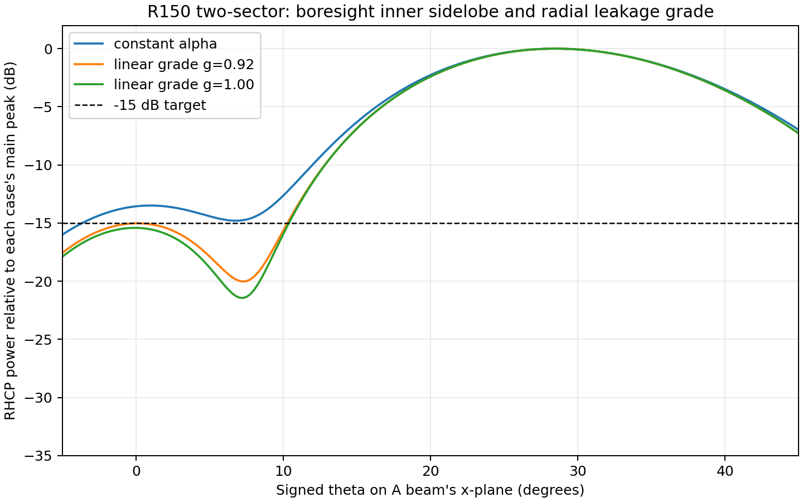

# R150 rerun at user-reported HFSS-pair map alpha = 1.33 Np/m

**Mode-list update:** The user subsequently supplied the raw HFSS modes. [HFSS_ANCHOR_BETA_SOFTWIDTH.md](HFSS_ANCHOR_BETA_SOFTWIDTH.md) inverts both bracketed y continuations and finds alpha 1.158 or 1.480 Np/m. Thus 1.33 remains an intermediate sensitivity case, not a uniquely confirmed inversion.

## Why the previous alpha differed

The previous aperture run used **2.36832 Np/m** from `baseline_7leg_w0p4_5.80GHz_n88.json`. `sub6_meander_corrected.py` obtains that number from the **MoM extracted sheet tensor**, with delta B = 9.32668 mS and hybrid TM-like beta/k0 = 1.066415 (x), 1.295841 (y), then calls `leakage_alpha_first_order_tensor` at 5.8 GHz. Those are model-derived inputs, not the separate HFSS anchor pair.

As a cross-check, applying the **40 mm PEC-lid beta-pair map** to the stored MoM TM-projection pair (1.066636, 1.294995) gives **2.30952 Np/m**; it differs from the direct MoM-tensor value by only **2.55%**. Therefore the 2.368-versus-1.33 discrepancy is primarily a **different input pair/sheet anisotropy**, not a 10.54-to-5.8 GHz scaling. Both alpha calculations here are explicitly at **5.8 GHz**. The numerical ratio 2.368/1.33 = 1.781 happens to be near 10.54/5.8 = 1.817 but does not establish frequency scaling. The subsequently supplied HFSS mode lists are audited in the linked update. **1.33 Np/m is used below as the user-specified intermediate map value.** Neither calculation is a measured alpha.

## R150 two-sector result

The aperture model is otherwise unchanged: ideal RHCP A at (30°, 0°), ideal LHCP B at (30°, 180°), rho^-1/2 exp(-integral alpha dr) surface-wave illumination with a 5.8 mm feed floor, 10 mm soft sector boundary, 5 mm aperture sampling, and a 1° upper-hemisphere scan. A 0.25° x-plane cut checks local extrema. Radial grading is alpha(r) = 1.33 [1 - g + g r/R] Np/m, capped at 1.33 everywhere. The radiated aperture field includes sqrt(2 alpha(r)). Ideal converted fraction is 1 - exp[-2 integral_0^R alpha(r) dr].

| Grade g | Alpha centre → edge (Np/m) | Worst SLL, both hands | Directivity per beam | Ideal conversion | Cost vs constant 1.33 |
|---:|---:|---:|---:|---:|---:|
| 0 | 1.330 → 1.330 | **-13.49 dB** | 18.97 dBi | **32.90%** | — |
| 0.92 | 0.106 → 1.330 | **-15.01 dB** | 19.45 dBi | **19.38%** | 13.52 percentage points |
| 1.00 | 0 → 1.330 | **-15.40 dB** | 19.46 dBi | **18.09%** | 14.81 percentage points |

The g=0.92 result clears the target by only **0.01 dB** on the sampled upper hemisphere; g=1.00 has 0.40 dB margin. The constant-alpha boresight lobe is each sector's first inner secondary local maximum, peaking 1.0° toward its beam (A: RHCP at phi 0°; B: LHCP at phi 180°). It is separated from the 28.5° main peak by a shallow local minimum at 6.75°, **not a true null**. Under both tested grades the worst lobe moves to boresight (theta 0°), where phi is degenerate.

The directivities are normalized to radiated power and hide the conversion reduction. This is MODEL_ONLY: the 1.33 value is user-reported from an HFSS beta pair, not a measured leakage constant; the specified radial alpha profile has not been realized by cells. IDC-specific validation remains deferred to the crop-testbed full-wave check once a cell reaches the top band.

Sources: `results/sub6_meander_model/corrected/baseline_7leg_w0p4_5.80GHz_n88.json`, `scripts/research/sub6_meander_corrected.py`, `scripts/research/sub6_beta_alpha_map.py`, `anchor_alpha133_result.json`, `anchor_alpha133_sphere.json`.

## HANDOFF

- STATUS: Recomputed at user-specified 1.33 Np/m; prior 2.368 run identified as MoM-sheet input.
- Cell JSON: corrected seven-leg MoM record; separate HFSS beta pair unavailable locally.
- beta/k0 along/across: stored MoM TM pair 1.066636/1.294995; this is not asserted to be the HFSS pair.
- alpha: 1.33 Np/m input; ideal conversion 32.90% ungraded, 19.38% at threshold grade.
- M_t, loss ratio: unchanged/unmeasured for the HFSS-pair scenario.
- HFSS or MODEL_ONLY: HFSS beta-pair map value user-reported; leakage and aperture outputs MODEL_ONLY.
- Next request: await crop-testbed full-wave check before IDC-specific validation.
