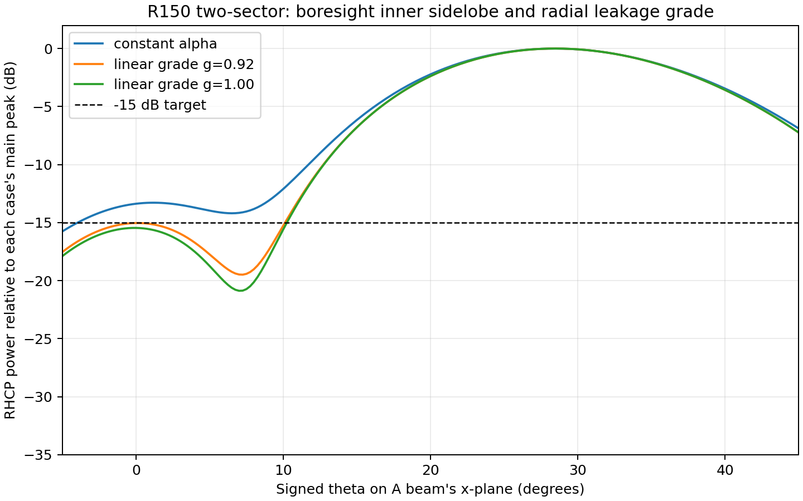

# R150 two-sector anchor leakage and radial grading (MODEL_ONLY)

The anchor is the corrected seven-leg baseline's first-order rotating-axis leakage potential, **alpha = 2.36832 Np/m** at 5.8 GHz. The aperture radius is 150 mm. The two ideal CP sectors use a 10 mm soft boundary and radial surface-wave amplitude proportional to rho^-1/2 exp(-integral alpha dr), floored at rho = 5.8 mm. The radiated field is multiplied by sqrt(2 alpha(r)); this is constant for the ungraded anchor and makes local conversion consistent when alpha is graded. Aperture sampling is 5 mm, upper-hemisphere angular sampling 1 degree, and the beam-plane cut is sampled at 0.25 degree.

**The boresight feature is each sector's first inner secondary local maximum.** On A's RHCP x-plane cut it peaks at theta **+1.25 degrees**, between boresight and the main peak at **+28.5 degrees**; a shallow local minimum at **+6.5 degrees** separates them. B's LHCP cut is the mirror at -1.25 and -28.5 degrees. This minimum is not a zero/null, so “first sidelobe” here means the first secondary local maximum toward boresight. The 1-degree upper-hemisphere search places A's worst sidelobe at (theta 1 degree, phi 0 degrees), and B's at (1 degree, 180 degrees), both **-13.28 dB**. The earlier 2-degree run gave -13.32 dB.

The tested radial grade is alpha(r) = alpha_anchor [1 - g + g(r/R)], with **0 <= g <= 1** and alpha nowhere above the anchor. Its local radiated amplitude is proportional to sqrt(2 alpha(r)/rho) exp[-integral_0^r alpha(s)ds]. The ideal fraction of launched surface-wave power converted within R is 1 - exp[-2 integral_0^R alpha(r)dr].

| Grade g | alpha at centre → edge (Np/m) | Worst SLL, either hand | Directivity per beam | Ideal conversion | Conversion cost vs constant anchor |
|---:|---:|---:|---:|---:|---:|
| 0 (constant anchor) | 2.368 → 2.368 | -13.28 dB | 18.84 dBi | 50.86% | — |
| 0.92 (threshold) | 0.189 → 2.368 | -15.03 dB | 19.42 dBi | 31.86% | 19.00 percentage points; -2.03 dB converted power |
| 1.00 (margin) | 0 → 2.368 | -15.45 dB | 19.44 dBi | 29.90% | 20.96 percentage points; -2.31 dB converted power |

The g=0.92 result clears -15 dB by only 0.03 dB in this sampled model. g=1.00 has 0.45 dB margin, but requires zero modulation at the centre and gives up about 21 percentage points of ideal conversion. The directivity values are normalized to radiated power; they do not include the conversion loss, feed loss, dielectric/conductor loss, or an absorber ring. The alpha range and grading law have not been demonstrated by a cell or full-wave board. No IDC-specific validation is claimed; that awaits the crop-testbed full-wave check when a cell reaches the top band.

Data: `anchor_radial_grade_result.json` (cut features, profile and conversion) and `anchor_radial_grade_sphere.json` (1-degree upper-hemisphere pattern summary). Reproduction: `scripts/research/sub6_anchor_radial_grade.py` and `scripts/research/sub6_meander_aperture.py`.

## HANDOFF

- STATUS: Anchor rerun and radial grade test complete.
- Cell JSON: corrected seven-leg anchor, alpha 2.36832 Np/m; no new cell solve.
- beta/k0 along/across: unchanged from corrected anchor; this is aperture analysis.
- alpha, M_t, loss ratio: alpha above; M_t unchanged; ideal conversion 50.86% baseline, 31.86% threshold grade.
- HFSS or MODEL_ONLY: MODEL_ONLY.
- Next request: wait for the crop-testbed full-wave check before IDC-specific validation or board claims.
