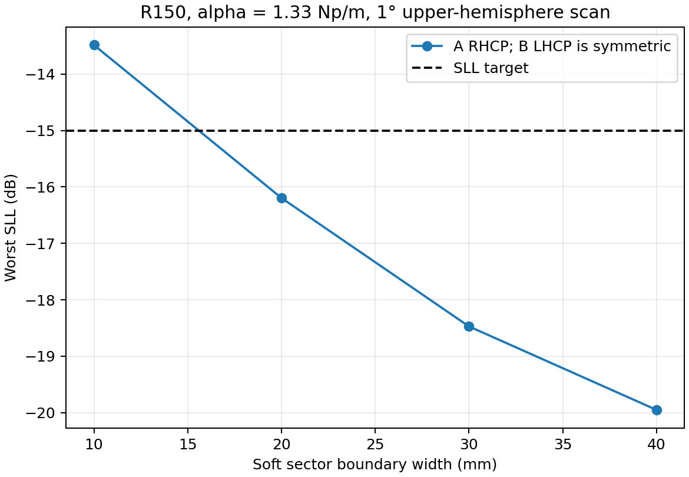

# HFSS anchor mode inversion and R150 soft-sector width

## Beta inversion

Cell: `ST_R5p45_L8p72_W2p91`, p = 11.6 mm, 5.8 GHz. Inputs are the user-supplied HFSS mode frequencies and Q, not a new HFSS solve. For each mode point, beta/k0 = (phase/360)(c/(p f)); beta/k0 at 5.8 GHz is linearly interpolated in (f, beta/k0). The sheet inversion uses RT5880 epsilon_r=2.2, tan_delta=0.0009, h=3.175 mm and a 40 mm PEC lid for the measured beta, then removes the lid to evaluate the first-order rotating-axis leakage potential at theta=30 degrees.

| Track through 85° → 95° | Q at 85° → 95° | beta/k0 at 5.8 | Brackets 5.8? | alpha (Np/m) with x track |
|---|---:|---:|---|---:|
| x: 5.553 → 5.925 GHz | 2038 → 1590 | **1.133523** | yes | — |
| y: 5.743 → 6.140 GHz | 3694 → 1755 | **1.069451** | yes | **1.1583** |
| y: 5.743 → 6.287 GHz | 3694 → 2586 | **1.064859** | yes | **1.4795** |

The 5.942 GHz mode at 85° is already above 5.8 GHz; pairing it with either 95° mode requires extrapolation and is not used for the 5.8 GHz surface-wave value. Q alone does not establish which 5.743 GHz → 95° continuation is correct. The bracketed pair with 6.140 GHz gives sheet Bx/By = 10.747/6.204 mS and mean/delta = 8.475/2.272 mS. **The raw mode lists do not uniquely confirm alpha = 1.33 Np/m.** At beta_x/k0=1.133523, exactly 1.33 requires beta_y/k0=**1.066865**, between the two bracketed continuations. Thus 1.33 is consistent with the approximate stated beta_y range, but is not the output of either discrete pairing.

## Soft-sector boundary rerun

The R150 ideal array factor uses the **requested alpha=1.33 Np/m**, rho^-1/2 exp(-alpha rho) illumination with rho floored at 5.8 mm, ideal RHCP/LHCP sectors, and the same 5 mm aperture / 1° upper-hemisphere grid as the previous correction. The soft boundary uses `sqrt((1+tanh(x/w))/2)` for RHCP and its complementary amplitude for LHCP. Local squared amplitudes sum to one, so changing w carries **no radial conversion cost in this model**: ideal conversion stays 32.90% for constant alpha.

| Soft width w | Worst SLL, both hands | Worst lobe | Directivity per beam | AR / XPD at beam |
|---:|---:|---|---:|---:|
| 10 mm | -13.49 dB | A: RHCP (1°, 0°); B: LHCP (1°, 180°) | 18.97 dBi | 0.86 / 26.10 dB |
| **20 mm** | **-16.20 dB** | A: RHCP (2°, 0°); B: LHCP (2°, 180°) | 19.40 dBi | 0.23 / 37.40 dB |
| 30 mm | -18.47 dB | same respective hands/directions at 2° | 19.76 dBi | 0.11 / 44.08 dB |
| 40 mm | -19.95 dB | same respective hands/directions at 2° | 20.04 dBi | 0.08 / 47.18 dB |

Using the **1.1583 Np/m** value from the 6.140-GHz bracketed y track changes the 20/30/40-mm SLL to **-16.23/-18.51/-19.98 dB**, respectively. The soft-width conclusion is insensitive to this anchor-alpha ambiguity in this array-factor model. Unlike radial leakage grading, the soft boundary does not lower the ideal conversion; it assumes a spatial transition that mixes hand weights and has not been realized by cells. These directivities are normalized to radiated power. No feed, absorber ring, finite loss, or full-wave board is included. IDC-specific validation still waits for the crop-testbed full-wave check.

Data: `hfss_beta_softwidth.json`; reproduction: `scripts/research/sub6_anchor_hfss_beta_softwidth.py` and `scripts/research/sub6_beta_alpha_map.py`.

## HANDOFF

- STATUS: Two bracketed y continuations audited; 1.33 lies between their inferred alphas.
- Cell JSON: `hfss_beta_softwidth.json`; no new HFSS solve.
- beta/k0 x/y: x 1.133523; y 1.069451 or 1.064859.
- alpha: 1.1583 or 1.4795 Np/m by track; 1.33 used for requested soft-width sweep.
- M_t, loss ratio: not measured from these real-beta mode lists.
- HFSS or MODEL_ONLY: HFSS mode inputs; alpha and array factor MODEL_ONLY.
- Next request: field overlap or denser phase sweep to resolve y-branch tracking; crop-testbed full-wave check for IDC leakage.
