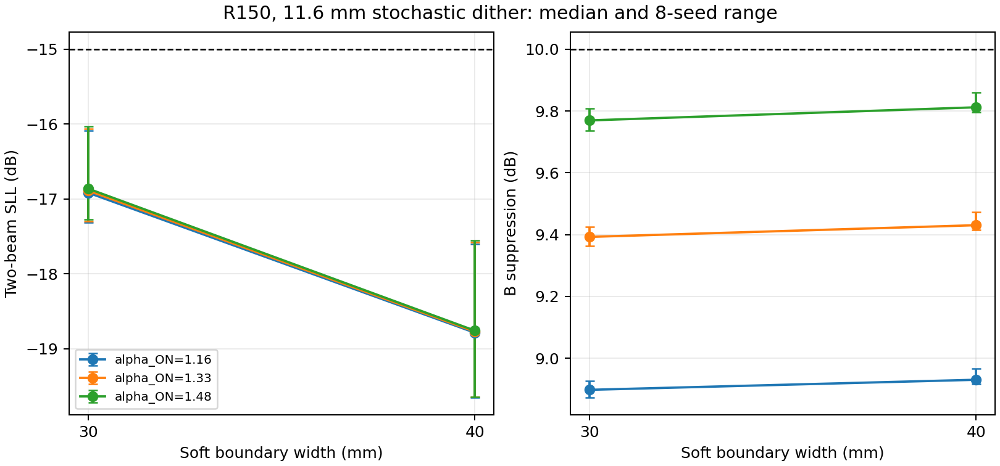

# R150 two-sector dither on the 11.6 mm cell grid (MODEL_ONLY)

The accepted radiating-cell alpha range is **1.16–1.48 Np/m** (1.33 intermediate); the B-OFF leakage is **0.13 Np/m** as specified. No new cell alpha was requested or calculated. The disk has R=150 mm and 516 radiating lattice centres at 11.6 mm pitch; the central cell is reserved for the feed. Eight deterministic stochastic-dither seeds were evaluated at each width and alpha. At each x column, the B-cell count approximates the soft probability `p_B(x)=[1-tanh(x/w)]/2`, with the selected y locations randomized. Every cell is assigned to exactly one hand. [Example 30 mm layout](layout_w30_seed0.png) and [40 mm layout](layout_w40_seed0.png) show seed 0.

For a launched radial surface wave, each cell's radiated field amplitude is proportional to `sqrt(2 alpha_local/rho) exp[-integral_0^rho alpha(s)ds]`, with the integral taken through the nearest assigned cells along its ray. A cells radiate RHCP toward (30°,0°); B cells radiate LHCP toward (30°,180°). In the one-beam state B-assigned cells have alpha=0.13 Np/m and **retain the coherent B phase ramp** as a conservative residual-beam assumption. The feed region is nonradiating. The array factor samples the upper hemisphere every 2°, with a 1° check of the worst 1.33-Np/m seeds.

Values below are medians across eight dither seeds; the `worst SLL` column is the least favourable seed (largest dB). B suppression is the two-beam B-target intensity divided by the one-beam residual B-target intensity at equal launched surface-wave amplitude. A change is the target A intensity in the one-beam state relative to the two-beam state.

| Soft width | alpha_ON | Two-beam SLL median / worst | Two-beam B−A | One-beam B suppression | One-beam A change | Ideal conversion two → one |
|---:|---:|---:|---:|---:|---:|---:|
| 30 mm | 1.16 | -16.92 / -16.09 dB | -0.02 dB | 8.90 dB | +0.13 dB | 28.3% → 16.5% |
| 30 mm | 1.33 | -16.89 / -16.06 dB | -0.02 dB | 9.39 dB | +0.15 dB | 31.7% → 18.4% |
| 30 mm | 1.48 | -16.86 / -16.03 dB | -0.02 dB | 9.77 dB | +0.16 dB | 34.6% → 19.9% |
| 40 mm | 1.16 | -18.79 / -17.60 dB | -0.12 dB | 8.93 dB | +0.17 dB | 28.3% → 16.7% |
| 40 mm | 1.33 | -18.77 / -17.58 dB | -0.12 dB | 9.43 dB | +0.20 dB | 31.7% → 18.5% |
| 40 mm | 1.48 | -18.76 / -17.56 dB | -0.13 dB | 9.81 dB | +0.22 dB | 34.6% → 20.1% |

Thus the dithered two-beam SLL clears **-15 dB** for every tested seed at both widths. The wider boundary improves the median SLL by about 1.9 dB. At alpha_ON=1.33, continuous soft weights had -18.47/-19.95 dB for 30/40 mm; the actual binary dither model degrades those medians by about 1.6/1.2 dB. The 1° check of the least favourable 1.33-Np/m seeds gave **-16.06 dB (30 mm)** and **-17.59 dB (40 mm)**, confirming the 2° scan for those patterns.

**The one-beam suppression target of 10 dB is not reached** in this coherent-residual model: even at alpha_ON=1.48 the median is 9.77/9.81 dB for 30/40 mm, and every tested seed remains below 10 dB. At 1.33, the residual B beam is about 9.55/9.72 dB below the surviving A beam for 30/40 mm. Reducing B leakage also lowers ideal board conversion by roughly 12–15 percentage points. These are relative array-factor intensities at equal launch, not validated realized gains.

Choices/limits: stochastic column-stratified dither; seed set 0–7; circular truncation at R150; one central feed cell removed; no absorber ring; nearest-cell radial ray attenuation; ideal circular polarization and fixed beam phase; no change of B-cell phase, beta, or polarization after switching; no feed or conductor/dielectric loss. The OFF leakage alone cannot establish the residual B radiation phase. The 30/40 mm transitions occupy several cell columns and require a realizable binary cell layout. No full-wave board or crop-testbed result is claimed.

Data: `dither_grid.json`; 1° checks: `../dither_grid_refine/dither_grid.json`; reproduction: `scripts/research/sub6_sector_dither_grid.py`.

## HANDOFF

- STATUS: 30/40 mm dither and B-OFF one-beam state modeled on 11.6 mm grid.
- Cell JSON: `dither_grid.json`; 516 radiating cells plus reserved centre feed cell.
- beta/k0 along/across: no new cell dispersion; accepted anchor alpha range used.
- alpha: ON 1.16/1.33/1.48; B OFF 0.13 Np/m.
- M_t, loss ratio: not evaluated in this aperture model.
- HFSS or MODEL_ONLY: MODEL_ONLY; no new HFSS solve.
- Next request: refine a cell and verify OFF phase/polarization and leakage in the crop testbed before board claims.
