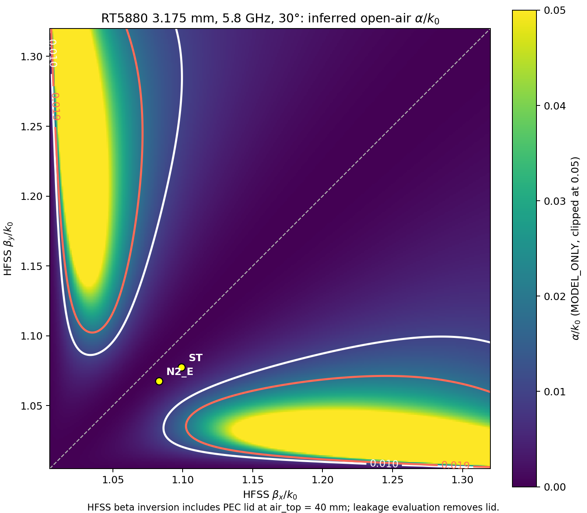

# HFSS beta-pair to leakage map (MODEL_ONLY)

For the grounded RT5880 slab (epsilon_r 2.2, tan_delta 0.0009, h=3.175 mm) at 5.8 GHz, the map takes HFSS TM beta_x/k0 and beta_y/k0 directly on its axes. White and coral contours mark alpha/k0 = **0.010** and **0.019** respectively (alpha = 1.216 and 2.310 Np/m). The numerical grid has spacing 0.001 on both axes; `beta_alpha_map.csv` contains every point.

The supplied HFSS cell uses a PEC lid 40 mm above the top copper (`air_top`). Accordingly, the inversion uses `Y_air,PEC = j omega epsilon0 coth(kappa h)/kappa` and `B_sheet = -Im(Y_air,PEC + Y_slab)` for each measured beta. The inferred sheet is then evaluated **with open air**: solve the mean TM beta with `find_beta_from_sheet_admittance`, then call `leakage_alpha_first_order_tensor` at theta 30 degrees. This is the potential leakage of a rotating-axis hologram made from the inferred tensor. **The actual PEC-lidded cell cannot radiate power to the far field**, so the map is not its measured attenuation. The 35 um copper-plane offset changes the lid distance by at most 0.035 mm; here 40.000 mm is measured from the top copper.

| HFSS beta pair (x/y) | B_sheet x/y (mS) | Mean/delta B (mS) | Open beta_mean/k0 | alpha/k0 | alpha (Np/m) |
|---|---:|---:|---:|---:|---:|
| N2_E 1.0830 / 1.0675 | 7.3605 / 6.0176 | 6.6890 / 0.6715 | 1.07101 | 0.001045 | 0.1270 |
| ST 1.0990 / 1.0776 | 8.5279 / 6.9241 | 7.7260 / 0.8019 | 1.08495 | 0.001400 | 0.1702 |

The earlier open-air inversion of the N2_E pair gave alpha/k0 = 0.000820. Accounting for the HFSS lid during beta inversion raises the inferred value by about 27%. Both remain far below 0.010. Grid interpolation was checked against direct calls at both HFSS pairs and near both requested contours to absolute alpha/k0 error < 1e-5.

## Realistic-illumination, two-sector R150 sidelobe rerun

The array-factor calculation used radial amplitude proportional to rho^-1/2 exp(-0.1270 rho), with rho floored at 5.8 mm, and a 10 mm soft sector boundary. Each sector has ideal circular polarization, and the angular grid is 2 degrees. Alpha is the N2_E first-order potential above, **not a measured board attenuation**.

| Beam | Peak direction | Directivity | Worst SLL | Worst-lobe location/hand | AR | XPD |
|---|---|---:|---:|---|---:|---:|
| A, RHCP (30°, 0°) | (28°, 0°) | 19.11 dBi | -13.75 dB | boresight (theta 0°, RHCP) | 0.82 dB | 26.54 dB |
| B, LHCP (30°, 180°) | (28°, 180°) | 19.11 dBi | -13.75 dB | boresight (theta 0°, LHCP) | 0.82 dB | 26.54 dB |

The two hands are degenerate in phi at theta 0°. The -15 dB SLL target is not met in this idealized array factor. Directivity uses upper-hemisphere power and a cos(theta) element factor. The SLL search takes local maxima outside an approximate 17.29 degree first-null exclusion cone for each beam. No HFSS board, feed, coupling, finite-conductor loss, or real CP element is represented.

## HANDOFF

- STATUS: Map and realistic-illumination sidelobe rerun complete.
- Cell JSON: `summary.json`; grid in `beta_alpha_map.csv`.
- beta/k0 along/across: N2_E x/y = 1.0830/1.0675; ST = 1.0990/1.0776.
- alpha: N2_E 0.1270 Np/m; contours at 1.216 and 2.310 Np/m.
- M_t, loss ratio: not inferred from this map; sheet conductance is unavailable from real beta alone.
- HFSS or MODEL_ONLY: HFSS beta inputs, MODEL_ONLY alpha and array factor.
- Next request: HFSS pairs can be read directly from the plot or CSV; validate leakage with an IDC-specific complex root or measured attenuation.
